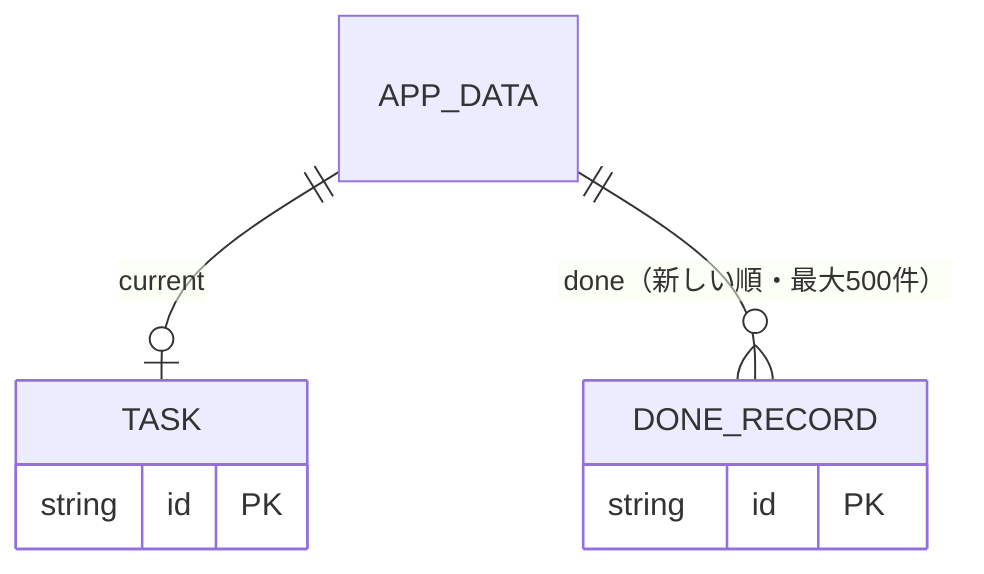

# ひとつめ — 設計

Vivaldi の新しいタブに指定する1画面のダッシュボード。gaman-log と同じ骨組み（Vite + React + TypeScript + vite-plugin-pwa、GitHub Pages、localStorage）で作る。拡張機能は作らない（Vivaldi は任意の URL を新しいタブに指定できる）。

2026-11-06 に「今やること」だけの画面からダッシュボードへ広げた（[002](decisions/002_dashboard.md)）。ユーザーは Ctrl+T を使わず、ブックマークを新しいタブで開くため、今やることだけでは目に入る理由が足りなかった。見た目は見本「一日の軸」（今日の予定を横軸に置き、その下に同じ重みの箱と読み物を並べる）をユーザーが選んだ。

## 成功条件

1. 新しいタブを開いた瞬間（オフラインでも、係が止まっていても）に今やることが出る
2. 決める → 一手済んだ → 全部済んだ → 元に戻す が、マウスのみ・キーボードのみのどちらでも完了できる
3. 複数のタブで開いていても、どれかで変えた内容がほかのタブに反映される
4. Tab の順序が正しく、操作後のフォーカスの行き先が決まっている
5. 係が止まっていても画面は崩れず、案内は上に1回だけ出る。係の欄は「係につながると出ます」とだけ出す

## データ

| キー | 置き場 | 中身 |
|---|---|---|
| `hitotsume:v1` | localStorage | `AppData`（`version: 1`・`current`・`done`） |
| `hitotsume:unreadable-backup` | localStorage | 読めなかった保存データの写し。上書きで消さないために退避する |
| `hitotsume:theme` | localStorage | `"light"` / `"dark"`（既定 light。OS の設定には追従しない） |
| `hitotsume:draft` | sessionStorage | 入力欄の書きかけ。タブごと。再読み込みで戻す |
| `hitotsume:links` | localStorage | よく見るサイト `{id, name, url}[]`（最大12件・http/https だけ） |
| `hitotsume:weather` | localStorage | 天気の場所 `{name, latitude, longitude}`（既定 東京） |
| `hitotsume:noteTag` | localStorage | note のタグ（既定 デザイン。`/?#\%` を含むものは保存しない） |
| `hitotsume:icons` | localStorage | サイトの URL ごとに係が探したアイコンの URL と時刻（7日で探し直す） |

- 状態の変化は `src/model.ts` の純関数に集め、テストする
- 文字列は空白をまとめて前後を削り、200文字（コードポイント）で切る

## ほかのタブとの関係

- `storage` イベントと `visibilitychange`（見えたとき）で読み直す。開いている入力欄の書きかけは消さない
- すべての操作は、実行直前に最新の保存内容を読み直してから行う。対象の `current.id` が変わっていたら保存せず「ほかのタブで変わったので、最新の内容を表示しました」と出す
- 元に戻すは、保存中の内容が自分の直前の操作結果と一致するときだけ戻す。違えば「ほかのタブで変わったので戻せません」

## 画面

上から順に次の4段。1024px 未満では箱を2列、768px 未満では1列に積む。予定の軸は幅640px を下限に横スクロールする。

幅1024px 以上ではページをスクロールさせず1画面に収める。残りの高さは読み物の段が受け持ち、入る行だけを出す（一覧は入りきらない行を隠し、作問の種と Wikipedia の本文は入る行数で切る）。読み物の段が160px を切るとき（目安は高さ約850px 未満、または予定が重なって段が増えた日）だけページが伸びる。「ほかN件」で開いた一覧は欄の中でスクロールする。仕組みは styles.css の「広い画面は1画面に収める」と src/dashboard/fit.ts。

1. 日付と天気の一言、よく見るサイトの丸ボタン（＋で足す・消す）、テーマ切り替え、使い方（？のアイコン。押すと重ねて開く枠）。サイトのアイコンは係の `/icon` が探した画像（下の「係」）。係につながらなければサイトの `/favicon.ico`、無ければ頭文字。探した結果は `hitotsume:icons` に7日控える。どれも 20px の枠に収め、ダークでは白い下地を敷く
2. 予定の軸: 上に「‹ 今日 11月6日（金） ›」。前後60日まで日を切り替えられ、今日以外では今の線を出さず「予定 N件」と「今日に戻る」を出す。既定 9〜19 時。はみ出す予定があれば広げる。過去は灰色、進行中は枠を付ける。今の線に時刻と「次の「◯◯」まで あと N分」。重なりは最大3段、50分未満の予定は名前を枠の右に出し、名前の分まで同じ段に入れない。終日の予定と今日をまるごと覆う予定は軸の上に小さく
3. 同じ重みの3つの箱: 今やること（未入力なら2欄と「決めた」、表示中は一手を大きく・ボタン「一手済んだ N」「全部済んだ D」「書き直す E」・今日済んだこと N は見出しの右）、Claude の使用量（枠ごとの横棒。80% 以上はオレンジ）、天気（今日と明日を日付・曜日つきで左右に並べる。下に取得元 Open-Meteo）
4. 読み物4列: Tech News（「今朝のハイライト」の節の全件に要約を2行まで・「ほかN件」でほかの節を開く）、作問の種（1件ずつ「次の種」）、Wikipedia（ランダム・「別の記事」。引き直す間は今の記事を残し、ボタンを「読み込み中」にする）、note（タグの人気3件をサムネつきで・「タグを変える」）。その日の分が無ければ直近の日の分に日付を添える

- ページの外へのリンクはすべて別窓（`target="_blank" rel="noopener noreferrer"`）
- 「使い方」の枠に、新しいタブへの出し方と、係の欄が出ないときの直し方を書く。開いている間は N・D・E のキーを効かせない
- 動き: 開いたとき上の段から順に浮かび上がる、予定の箱が左から伸びる、今の点が脈打つ、使用量の棒が伸びる、天気の絵が回る・流れる・降る、読み物の行が滑り込む、種と Wikipedia の差し替えでぼかしから現れる、箱は触れると浮く
- 取り直しの間隔: 予定・使用量 5分、天気・Tech News・種・note 30分。タブが裏の間は取らず、表に戻ったとき1分より古ければ取り直す
- フォーカスの行き先: 一手済んだ・書き直すを閉じる → 押したボタン／全部済んだ → 1欄目／元に戻す → 戻った状態の主ボタンか1欄目
- 演出は reduced-motion でも止めない（ユーザーの方針）

## 更新・文字・テーマ

- 新しい版は `registerType: "prompt"` で待たせ、タブが裏にあり書きかけが無いときだけ切り替えて再読み込みする。開いている全タブが一斉に再読み込みして書きかけが消えるのを防ぐ
- 文字は `@fontsource-variable/noto-sans-jp` を自前で配信し、precache に入れる。オフラインでも欠けない。見本は IBM Plex Sans JP だったが、自作アプリの書体は Noto Sans JP と決まっているので戻した（2026-11-06）
- CSP の `connect-src` は自分・係（`http://127.0.0.1:47615`）・Open-Meteo（予報・地名検索）・ja.wikipedia.org だけ。`img-src` は `https:` 全体（各サイトのファビコンと note のサムネを読むため。画像だけで、通信先は広げていない）。React の style 指定は CSSOM 経由なので `style-src 'self'` のままで動く
- `public/theme.js` を head で同期読み込みし、React 起動前に `<html data-theme>` を付ける。CSP がインラインスクリプトを禁じているので外部ファイルにした

## 係（helper/）

- `node helper/server.ts`（Node 24 の型の読み飛ばしで動く・依存なし）。`127.0.0.1:47615` だけで待つ
- 何かをする前に `Host`（127.0.0.1／localhost:47615）と `Origin`（公開 URL。環境変数 `HITOTSUME_DEV` があるときだけ localhost:5173・4173 も）を確かめ、外れたら 403。ほかのサイトや別プロジェクトの開発ページから PowerShell を動かされないため
- 端点: `/version`・`/calendar?date=YYYY-MM-DD`（省略で今日。暦にある日で前後400日以内だけ）・`/icon?url=`・`/technews`・`/seeds`・`/note?tag=`・`/usage`。応答は `{ok:true, data, date?}` か `{ok:false, reason}`。控えは端点ごとに持ち、同時の要求は1回の取得に相乗りさせる。失敗は30秒だけ控える
- `/icon?url=` はよく見るサイトのアイコンを探す。①ページの HTML が指定する icon（SVG を先に、無ければ 32px 以上で一番小さいもの）②Google の控え（`t3.gstatic.com/faviconV2`。200 のときだけ）③サイトの `/favicon.ico`。ページが別のホスト（ログイン画面）へ飛ばしたら①は使わない。サイト共通の favicon.ico だけを読むと、Google マップも Gmail も `www.google.com` の「G」になる（2026-11-06 に指摘）。Google の控えは無いページにも地球の絵を 404 つきで返し、画面の img では見分けられないので、状態を見られる係で確かめる。この PC と家の中のネットワーク（localhost・10.・192.168. など）は探しに行かない。結果は24時間控える
- note は `https://note.com/api/v3/hashtags/{タグ}/notes?order=hot`（非公式。タグページの「人気」タブに近い並び）から取る。取れなければ公式の RSS（新着順）に切り替え、画面の見出しを「の新着」にする。人気の上位20件までを `/api/v3/notes/{key}` で1件ずつ読み、タグを11個以上付けた記事と PR の記事（題名の【PR】・タグの #PR など）を外して5件にする。上位には関係の薄いタグを15〜25個付けて広く出す記事や宣伝が多かったため（2026-11-06 にユーザーが「アフィ記事ばかり」と指摘）。記事のタグは1日控える。RSS に切り替えたときはふるい分けない。サムネは `assets.st-note.com` のものだけ通す。note のタグには「急上昇」が無い（急上昇は note 全体の一覧だけ。2026-11-06 に確認）
- 予定は `outlook-today.ps1 -Date YYYY-MM-DD` を PowerShell 5.1 で動かす（`GetActiveObject` で起動中の Outlook にだけつなぐ。50件・20秒で打ち切り・窓は出さない）。ps1 は BOM 付き UTF-8 で保存する。BOM が無いと PowerShell 5.1 が日本語コメントの次の行を読み落とす（2026-11-06 に実測）
- 使用量は `~/.claude/.credentials.json` のアクセストークンで `GET https://api.anthropic.com/api/oauth/usage` を呼び、`limits[]` を枠の一覧に直す。トークンはメモリにだけ置き、応答・ログ・ファイルに出さない。期限切れでも更新しない（Claude Code の保存済みログインを回してしまうため）
- 起動はスタートアップのショートカット（`conhost.exe --headless powershell … start.ps1`）。`start.ps1` はポートが使用中なら何もしない。`-Restart` で止めて起動し直す

## やらないこと

Teams・Gmail・Cursor との連携、note のログインが要る「おすすめ」、週の棒グラフ、係を PC の外へ開くこと、端末間の同期、複数タスクの一覧、通知、拡張機能化。

## 未確認

- 公開ページ（https）から係（http://127.0.0.1）へのつながり。Chromium の Local Network Access で許可を聞かれる見込み。内蔵ブラウザは公開サイトから PC 内への接続を止めるため、手元では確かめられなかった。通らなければ係が画面ごと配る形（002 の案B）に切り替える
- 使用量の窓口は非公式。形が変われば「今は取れません」と出る。アクセストークンの期限切れ後、デスクトップアプリだけの利用で `.credentials.json` が更新されるかは確かめていない

- Vivaldi の新しいタブでのフォーカスの位置（アドレスバーに乗る見込み）。実機で確かめる
- 手元のプレビュー（内蔵ブラウザ）では Service Worker の登録が失敗する。公開先で登録されることを確かめる
