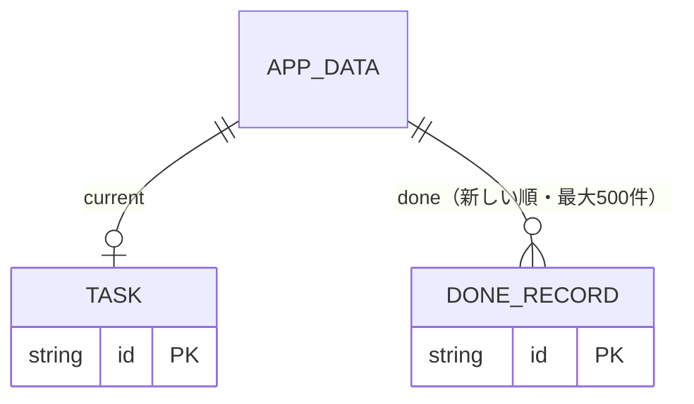

# ひとつめ — 設計

Vivaldi の新しいタブに指定する1画面の Web アプリ。gaman-log と同じ骨組み（Vite + React + TypeScript + vite-plugin-pwa、GitHub Pages、localStorage）で作り、「今やること」1件と「最初の一手」だけを大きく出す。拡張機能は作らない（Vivaldi は任意の URL を新しいタブに指定できる）。

## 成功条件

1. 新しいタブを開いた瞬間（オフラインでも）に今やることが出る
2. 決める → 一手済んだ → 全部済んだ → 元に戻す が、マウスのみ・キーボードのみのどちらでも完了できる
3. 複数のタブで開いていても、どれかで変えた内容がほかのタブに反映される
4. Tab の順序が正しく、操作後のフォーカスの行き先が決まっている

## データ

| キー | 置き場 | 中身 |
|---|---|---|
| `hitotsume:v1` | localStorage | `AppData`（`version: 1`・`current`・`done`） |
| `hitotsume:unreadable-backup` | localStorage | 読めなかった保存データの写し。上書きで消さないために退避する |
| `hitotsume:theme` | localStorage | `"light"` / `"dark"`（既定 light。OS の設定には追従しない） |
| `hitotsume:draft` | sessionStorage | 入力欄の書きかけ。タブごと。再読み込みで戻す |

- 状態の変化は `src/model.ts` の純関数に集め、テストする
- 文字列は空白をまとめて前後を削り、200文字（コードポイント）で切る

## ほかのタブとの関係

- `storage` イベントと `visibilitychange`（見えたとき）で読み直す。開いている入力欄の書きかけは消さない
- すべての操作は、実行直前に最新の保存内容を読み直してから行う。対象の `current.id` が変わっていたら保存せず「ほかのタブで変わったので、最新の内容を表示しました」と出す
- 元に戻すは、保存中の内容が自分の直前の操作結果と一致するときだけ戻す。違えば「ほかのタブで変わったので戻せません」

## 画面

- 未入力: 2欄（今やること・最初の一手）と「決めた」
- 表示: 小さく今やること、特大で最初の一手。ボタンは「一手済んだ N」「全部済んだ D」「書き直す E」
- 共通: 左上に時刻（タブが裏にある間は更新を止める）、右上にテーマ切り替え、下に「今日済んだこと N 件」、折りたたみの「新しいタブに出すには」
- フォーカスの行き先: 一手済んだ・書き直すを閉じる → 押したボタン／全部済んだ → 1欄目／元に戻す → 戻った状態の主ボタンか1欄目
- 演出は reduced-motion でも止めない（ユーザーの方針）

## 更新・文字・テーマ

- 新しい版は `registerType: "prompt"` で待たせ、タブが裏にあり書きかけが無いときだけ切り替えて再読み込みする。開いている全タブが一斉に再読み込みして書きかけが消えるのを防ぐ
- 文字は `@fontsource-variable/noto-sans-jp` を自前で配信し、precache に入れる。オフラインでも欠けない
- `public/theme.js` を head で同期読み込みし、React 起動前に `<html data-theme>` を付ける。CSP がインラインスクリプトを禁じているので外部ファイルにした

## やらないこと

予定・メール・ToDo サービスとの連携、端末間の同期、複数タスクの一覧、通知、拡張機能化。

## 未確認

- Vivaldi の新しいタブでのフォーカスの位置（アドレスバーに乗る見込み）。実機で確かめる
- 手元のプレビュー（内蔵ブラウザ）では Service Worker の登録が失敗する。公開先で登録されることを確かめる
